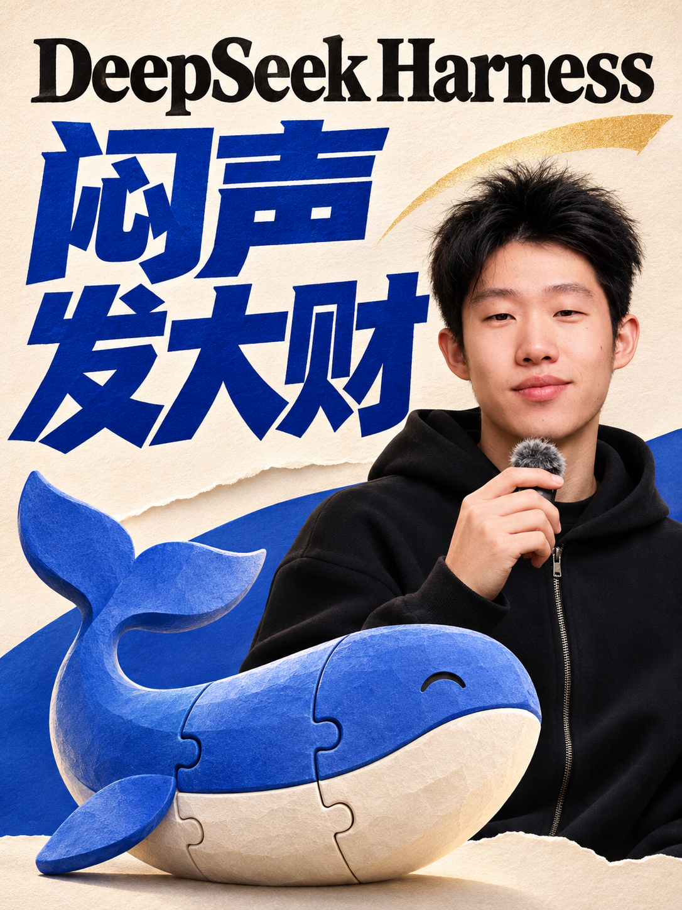
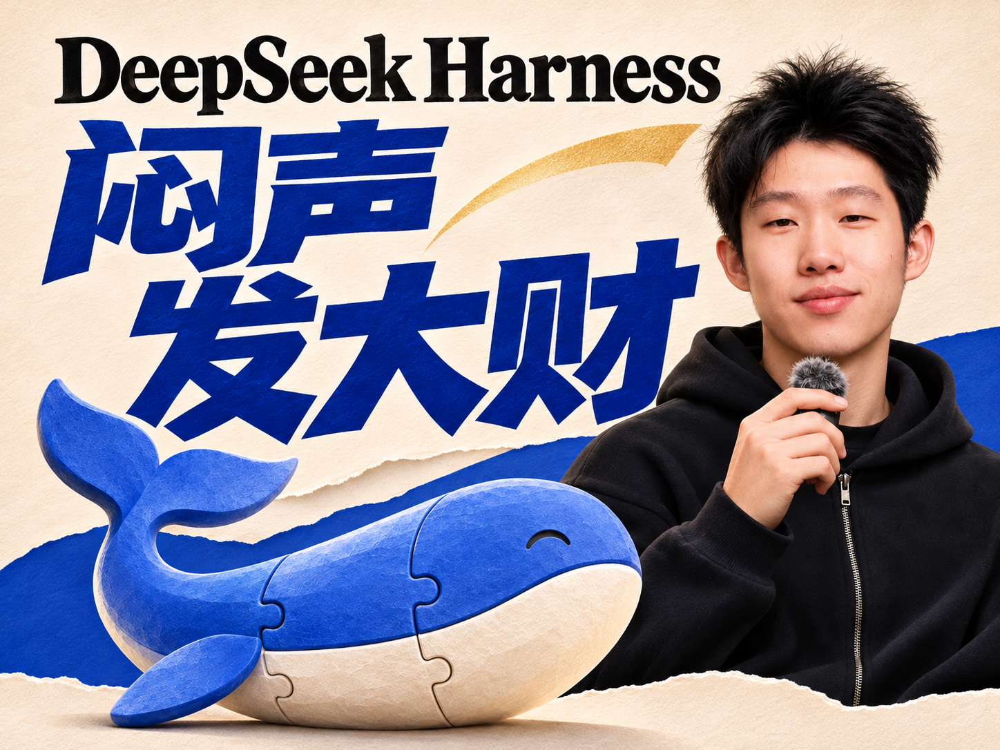

# Showcase：DeepSeek Harness「闷声发大财」人像版

本案例来自一段口播试片与完整脚本。用户给定标题，选中人像路线，在比较两张加强互动的改版后回选原版。最终交付为原生 3:4 与 4:3 各一张。

| 竖版 | 横版 |
| --- | --- |
|  |  |
| 1086 × 1448 | 1448 × 1086 |

## 可复用的判断

- **先用用户给定的标题。** `DeepSeek Harness` 是产品锚点，`闷声发大财` 是中文主标题；不再组织一轮标题选择，不把比喻扩写成收入或收益保证。
- **自然人像承接个人讲述。** 黑色连帽衫、手持麦克风、自然微笑保持口播者的身份感。没有为了“吸引点击”而默认安排夸张表演。
- **一个主物即可。** 原创蓝色模块化鲸鱼把社区与插件生态转成可理解的视觉比喻。它不是官方 Logo，也不是用户或收入增长的证据。需要准确品牌物的其他任务仍应使用官方资产。
- **奶油底与钴蓝建立层级。** 英文黑色衬线字负责识别，蓝色中文大字负责第一眼阅读；撕纸边、人物和鲸鱼形成一个空间，不补无关角标。
- **横版延续同一设计。** 将选中竖版作为参考，保留人物、文字、蓝鲸和配色，原生重构标题与前景位置。没有裁切或拉伸竖图。

## 修改与回选

后续两张改版分别增加了“嘘”手势和人物与蓝鲸对视，并把“发大财”改为金色。用户比较后明确表示原版更好，因此最终选定回到原版及已有匹配横版。

这说明本案例里自然神态与整体统一更符合用户偏好，不能推导成“手势封面普遍更差”。两个改版同时改变了动作、字色与布局，也不是严格控制变量的点击率实验。新任务若需要测试，按用户意图选择变量，并保留原成片供比较。

## 效率与验证边界

默认阶段生成了两张竖版，选定后生成一张横版。两张互动改版是用户另行要求的探索，不属于默认交付成本。分析、标题、身份参考和选定图均在后续阶段复用；回选时直接交付已有文件。

用户认可此次效率与效果，但没有完整耗时基准或发布点击率数据。这里只记录实际流程和视觉选择，不写速度提升百分比或效果保证。

- 引擎：内置 `image_gen`；工具未报告具体模型版本。
- 检查：原图及 180 × 240 / 320 × 240 缩略图，确认文字、人物、构图与可读性。
- [最终两张的实际生成提示词、参考角色与文件校验值](../assets/showcase/deepseek-harness-portrait.prompts.json)。原始人物视频帧不随 Skill 分发；新任务需使用自己的身份参考。

## 适用范围

可用于个人视角的 AI 产品、工具生态或创作体验内容。引用本成片作为风格参考时，只学习层级、材质和空间关系；不能复制 Josh 的脸、DeepSeek 标题或蓝鲸到无关题材，也不能把它当作新的用户身份参考。
